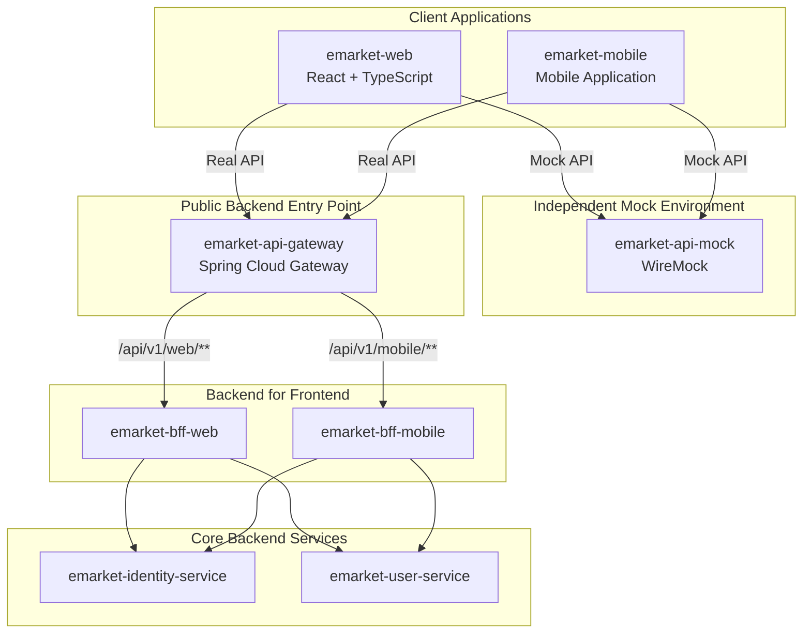

# emarket — Stage 1
## Architecture Overview & Technical Specification

**Document type:** Architecture / Technical Specification  
**Stage:** 1 — Foundation  
**Status:** Proposed  
**Backend language:** Java 21  
**Backend framework:** Spring Boot 4  
**Build system:** Gradle Kotlin DSL  
**Frontend:** React + TypeScript + Vite  
**Frontend styling:** SCSS Modules (`.module.scss`)

---

# 1. Project Overview

## 1.1. Purpose

`emarket` — учебный production-oriented проект интернет-магазина, предназначенный для практического освоения и демонстрации навыков Senior Java Fullstack Developer.

Проект разрабатывается на основе микросервисной архитектуры с независимыми backend-сервисами, отдельными репозиториями GitHub и возможностью постепенного расширения функциональности.

Stage 1 закладывает архитектурный фундамент проекта:

- Frontend application.
- API Gateway.
- Independent Mock API.
- Backend for Frontend (Web and Mobile).
- Identity and Access Management.
- User Management.

## 1.2. Architecture Principles

Основные архитектурные принципы:

1. Microservices Architecture.
2. Database per Service.
3. Backend for Frontend (BFF).
4. API Gateway as Single Public Entry Point for real backend APIs.
5. Independent Mock API.
6. Separation of Business Responsibilities.
7. Independent Deployment.
8. Environment-based Configuration.
9. Security by Design.
10. API Versioning.

---

# 2. Technology Stack

## 2.1. Frontend

| Technology | Purpose |
|---|---|
| React | UI framework |
| TypeScript | Static typing |
| Vite | Build tool and development server |
| SCSS Modules | Component-scoped styling |
| React Router | Client-side routing |
| Axios | HTTP client |
| TanStack Query | Server state management |
| Zod | Runtime data validation |
| i18next | Internationalization |
| Vitest | Unit and integration testing |
| React Testing Library | Component testing |
| Playwright | E2E testing |

Frontend application:

- `emarket-web`

## 2.2. Backend

| Technology | Purpose |
|---|---|
| Java 21 | Programming language |
| Spring Boot 4 | Application framework |
| Gradle Kotlin DSL | Build automation |
| Spring Security | Authentication and authorization |
| Spring Cloud Gateway | API Gateway |
| WireMock | Mock HTTP server |
| Spring Boot Actuator | Health checks and monitoring |
| JUnit 5 | Unit and integration testing |
| Mockito | Mocking |
| Testcontainers | Integration testing |

Backend services:

- `emarket-api-gateway`
- `emarket-api-mock`
- `emarket-bff-web`
- `emarket-bff-mobile`
- `emarket-identity-service`
- `emarket-user-service`

---

# 3. Microservices Architecture

## 3.1. High-Level Architecture

Stage 1 consists of six independent backend services and one frontend application.

The architecture has two different communication paths:

**Path A — Real Backend API**

Frontend → API Gateway → BFF → Internal Microservices

**Path B — Mock API**

Frontend → API Mock

The Mock API is intentionally accessed directly by frontend applications. It does not go through API Gateway.

## 3.2. Architecture Diagram



**Important:** Direct communication with `emarket-api-mock` is an intentional exception to the Single Public Entry Point principle. The exception applies exclusively to mock responses.

## 3.3. Communication Rules

| Source | Destination | Communication |
|---|---|---|
| emarket-web | emarket-api-gateway | HTTP/HTTPS |
| emarket-mobile | emarket-api-gateway | HTTP/HTTPS |
| emarket-web | emarket-api-mock | HTTP |
| emarket-mobile | emarket-api-mock | HTTP |
| emarket-api-gateway | emarket-bff-web | HTTP |
| emarket-api-gateway | emarket-bff-mobile | HTTP |
| emarket-bff-web | emarket-identity-service | Internal HTTP API |
| emarket-bff-web | emarket-user-service | Internal HTTP API |
| emarket-bff-mobile | emarket-identity-service | Internal HTTP API |
| emarket-bff-mobile | emarket-user-service | Internal HTTP API |

Rules:

1. Real backend requests must go through API Gateway.
2. Frontend applications must not communicate directly with BFF services.
3. Frontend applications must not communicate directly with Identity or User services.
4. Mock requests must go directly to API Mock.
5. API Mock must not depend on real backend services.
6. Mock API must not contain production business logic.
7. Internal backend services must not be publicly accessible.

---

# 4. Backend Services

## 4.1. emarket-api-gateway

**Purpose:** The single public entry point for real backend API requests.

Technology:
- Java 21
- Spring Boot 4
- Spring Cloud Gateway
- Gradle Kotlin DSL

Responsibilities:

- Request routing.
- Rate Limiting.
- Request filtering.
- CORS configuration.
- Correlation ID propagation.
- Centralized error handling.
- Forwarding requests to appropriate BFF services.

Routing:

| Public API | Destination |
|---|---|
| `/api/v1/web/**` | emarket-bff-web |
| `/api/v1/mobile/**` | emarket-bff-mobile |

Example:

```text
POST /api/v1/web/auth/login
        |
        v
emarket-api-gateway
        |
        v
emarket-bff-web
```

Architectural restrictions:

- No business logic.
- No user management.
- No authentication business logic.
- No direct database access.
- No direct communication with frontend business components.

Gateway is responsible for routing and infrastructure-level cross-cutting concerns.

## 4.2. emarket-api-mock

**Purpose:** Independent mock HTTP API providing predefined responses to frontend applications.

Technology:
- Java 21
- WireMock
- Gradle Kotlin DSL

Responsibilities:

- Provide predefined HTTP responses.
- Simulate backend API behavior.
- Support frontend development independently of backend implementation.
- Support different response scenarios.
- Simulate HTTP errors.
- Simulate empty responses and validation errors.
- Provide deterministic test data.

Communication:

```text
emarket-web --------\
                     \
                      > emarket-api-mock
                     /
emarket-mobile -----/
```

Mock API is independent of:

- API Gateway.
- BFF services.
- Identity Service.
- User Service.

Suggested WireMock organization:

```text
emarket-api-mock/
│
├── src/
│   └── test/
│       └── resources/
│           └── wiremock/
│               │
│               ├── mappings/
│               │   ├── auth/
│               │   ├── users/
│               │   ├── addresses/
│               │   └── preferences/
│               │
│               └── __files/
│                   ├── auth/
│                   ├── users/
│                   ├── addresses/
│                   └── preferences/
│
├── build.gradle.kts
└── README.md
```

Example mock endpoints:

| HTTP | Endpoint | Description |
|---|---|---|
| POST | `/api/v1/web/auth/register` | Mock registration |
| POST | `/api/v1/web/auth/login` | Mock login |
| POST | `/api/v1/web/auth/logout` | Mock logout |
| GET | `/api/v1/web/auth/me` | Mock current user |
| GET | `/api/v1/web/users/me` | Mock user profile |
| GET | `/api/v1/web/users/me/addresses` | Mock addresses |
| GET | `/api/v1/web/users/me/preferences` | Mock preferences |

Mobile-specific responses can use `/api/v1/mobile/**`.

**Important implementation decisions:**

- Mock API is intended for development and testing.
- Mock API must be disabled or inaccessible in production.
- Mock responses should follow the same API contracts as real BFF responses.
- Mock response definitions should be version-controlled.
- Frontend must be able to switch between Mock API and real API using environment configuration.

## 4.3. emarket-bff-web

**Purpose:** Backend for Frontend dedicated to the Web application.

Responsibilities:

- Expose Web-specific REST API.
- Aggregate data from internal services.
- Adapt internal service responses to Web API contracts.
- Manage browser-oriented authentication flows.
- Manage browser session and token lifecycle.
- Handle Web-specific request validation.
- Coordinate communication with Identity and User services.

Dependencies:

- emarket-identity-service
- emarket-user-service

Public API prefix:

```text
/api/v1/web
```

Example:

```text
POST /api/v1/web/auth/login
GET  /api/v1/web/users/me
```

The BFF must not duplicate business logic belonging to Identity or User services.

## 4.4. emarket-bff-mobile

**Purpose:** Backend for Frontend dedicated to the Mobile application.

Responsibilities:

- Expose Mobile-specific REST API.
- Aggregate data from internal services.
- Adapt responses to Mobile API contracts.
- Support mobile authentication and token lifecycle.
- Optimize API responses for mobile clients.
- Coordinate communication with Identity and User services.

Dependencies:

- emarket-identity-service
- emarket-user-service

Public API prefix:

```text
/api/v1/mobile
```

The Mobile BFF is independent of the Web BFF.

Both BFF services can use the same core business services without duplicating their business responsibilities.

## 4.5. emarket-identity-service

**Purpose:** Centralized identity, authentication and authorization management.

Responsibilities:

- User registration.
- Login and logout coordination.
- OAuth2 / OpenID Connect integration.
- JWT access tokens.
- Refresh token management.
- Token validation.
- Token revocation.
- Role-Based Access Control (RBAC).
- Password management.
- Forgot password.
- Reset password.
- Account security.

Example roles:

| Role | Description |
|---|---|
| ROLE_USER | Standard user |
| ROLE_ADMIN | Administrator |

The Identity Service is the owner of authentication and identity-related business logic.

BFF services must not implement their own authentication mechanisms.

## 4.6. emarket-user-service

**Purpose:** Management of user-related business information.

Responsibilities:

- User profile.
- User personal information.
- Delivery addresses.
- User preferences.
- Profile updates.
- Address management.
- Preferences management.

Example domains:

```text
User
 ├── Profile
 ├── Addresses
 └── Preferences
```

The User Service owns user profile and preference data.

Authentication credentials, passwords, refresh tokens and identity-related information belong to Identity Service.

---

# 5. API Architecture

## 5.1. API Versioning

All real backend API endpoints use:

```text
/api/v1
```

Web API:

```text
/api/v1/web/**
```

Mobile API:

```text
/api/v1/mobile/**
```

Mock API uses corresponding endpoint structures to maintain compatibility with frontend API contracts.

## 5.2. Authentication API

Web:

| HTTP | Endpoint | Description |
|---|---|---|
| POST | `/api/v1/web/auth/register` | Registration |
| POST | `/api/v1/web/auth/login` | Login |
| POST | `/api/v1/web/auth/logout` | Logout |
| POST | `/api/v1/web/auth/refresh` | Refresh tokens |
| GET | `/api/v1/web/auth/me` | Current authenticated user |
| POST | `/api/v1/web/auth/forgot-password` | Request password reset |
| POST | `/api/v1/web/auth/reset-password` | Reset password |

Mobile endpoints follow the same domain structure with `/mobile` instead of `/web`.

## 5.3. User API

| HTTP | Endpoint | Description |
|---|---|---|
| GET | `/api/v1/web/users/me` | Get profile |
| PATCH | `/api/v1/web/users/me` | Update profile |
| GET | `/api/v1/web/users/me/addresses` | Get addresses |
| POST | `/api/v1/web/users/me/addresses` | Add address |
| GET | `/api/v1/web/users/me/addresses/{addressId}` | Get address |
| PATCH | `/api/v1/web/users/me/addresses/{addressId}` | Update address |
| DELETE | `/api/v1/web/users/me/addresses/{addressId}` | Delete address |
| GET | `/api/v1/web/users/me/preferences` | Get preferences |
| PATCH | `/api/v1/web/users/me/preferences` | Update preferences |

Mobile BFF exposes corresponding Mobile-specific endpoints.

---

# 6. Frontend Architecture

## 6.1. emarket-web

Technology:

- React
- TypeScript
- Vite
- SCSS Modules

Responsibilities:

- User interface.
- Frontend routing.
- Authentication UI.
- User profile UI.
- Address management UI.
- Preferences UI.
- API integration.
- Client-side validation.
- Internationalization.
- Theme management.

Styling conventions:

```text
Component.tsx
Component.module.scss
```

SCSS Modules provide component-scoped styling and help prevent global CSS conflicts.

## 6.2. API Configuration

Frontend must support two independent API configurations:

1. Real backend API through API Gateway.
2. Mock API through API Mock.

Example `.env.development`:

```env
VITE_API_MODE=mock
VITE_API_BASE_URL=http://localhost:8080/api/v1
VITE_MOCK_API_BASE_URL=http://localhost:9090/api/v1
```

Example `.env.production`:

```env
VITE_API_MODE=real
VITE_API_BASE_URL=/api/v1
```

The frontend HTTP client should select the appropriate base URL according to `VITE_API_MODE`.

Production builds must not use the Mock API.

The Mobile application follows the same configuration principle.

## 6.3. Frontend Routes

| Route | Page | Access |
|---|---|---|
| `/` | Home | Public |
| `/login` | Login | Public |
| `/register` | Registration | Public |
| `/forgot-password` | Forgot Password | Public |
| `/reset-password` | Reset Password | Public |
| `/products` | Product Catalog Placeholder | Public |
| `/profile` | User Profile | Authenticated |
| `/profile/addresses` | User Addresses | Authenticated |
| `/profile/preferences` | User Preferences | Authenticated |
| `/403` | Forbidden | Public |
| `*` | Not Found | Public |

Product Catalog is a placeholder because Product Service is outside Stage 1.

---

# 7. Security Architecture

Security requirements:

1. All real backend APIs must be accessed through API Gateway.
2. Internal backend services must not expose public endpoints.
3. Authentication and authorization must be centralized in Identity Service.
4. RBAC must be supported.
5. Access tokens must have a limited lifetime.
6. Refresh tokens must support revocation and rotation.
7. HTTPS must be used in production.
8. Sensitive information must not be stored in frontend source code.
9. CORS must be explicitly configured.
10. Rate Limiting must be implemented at API Gateway.

For Web authentication, the preferred approach is a BFF-managed session using secure cookies:

- HttpOnly.
- Secure.
- SameSite.
- CSRF protection.

Long-lived refresh tokens should not be stored in browser localStorage.

Mock API must not be available in production.

---

# 8. Repository Structure

Each service is maintained in an independent GitHub repository.

```text
emarket/
│
├── emarket-web/
│
├── emarket-api-gateway/
│
├── emarket-api-mock/
│
├── emarket-bff-web/
│
├── emarket-bff-mobile/
│
├── emarket-identity-service/
│
├── emarket-user-service/
│
└── emarket-docs/
```

Each repository should contain:

- README.md
- Source code.
- Build configuration.
- Unit tests.
- Integration tests where applicable.
- GitHub Actions CI.
- Docker configuration.
- Environment configuration examples.
- Technical documentation.

---

# 9. Stage 1 Scope

## 9.1. Included

| Component | Stage 1 |
|---|---|
| emarket-web | Yes |
| emarket-api-gateway | Yes |
| emarket-api-mock | Yes |
| emarket-bff-web | Yes |
| emarket-bff-mobile | Yes |
| emarket-identity-service | Yes |
| emarket-user-service | Yes |
| Authentication | Yes |
| Registration | Yes |
| OAuth2 / OIDC foundation | Yes |
| JWT / Refresh Tokens | Yes |
| RBAC | Yes |
| User Profile | Yes |
| User Addresses | Yes |
| User Preferences | Yes |
| Mock API integration | Yes |
| GitHub CI | Yes |
| Docker support | Yes |
| API documentation | Yes |

## 9.2. Not Included

| Component | Stage 1 |
|---|---|
| Product Service | No |
| Product Catalog implementation | No |
| Shopping Cart | No |
| Order Service | No |
| Payment Service | No |
| Inventory Service | No |
| Delivery Service | No |
| Search Service | No |
| Notification Service | No |
| Admin Panel | No |

These components can be introduced in subsequent development stages.

---

# 10. Architectural Decisions Summary

| ID | Decision |
|---|---|
| ADR-001 | Microservices Architecture |
| ADR-002 | Independent GitHub Repository per Service |
| ADR-003 | API Gateway as the Single Public Entry Point for Real APIs |
| ADR-004 | Independent Mock API using WireMock |
| ADR-005 | Direct Frontend-to-Mock API Communication |
| ADR-006 | Backend for Frontend Pattern |
| ADR-007 | Separate Web and Mobile BFF |
| ADR-008 | Centralized Identity Management |
| ADR-009 | Separate User Management Service |
| ADR-010 | Java 21 + Spring Boot 4 |
| ADR-011 | Gradle Kotlin DSL |
| ADR-012 | React + TypeScript + Vite |
| ADR-013 | SCSS Modules |
| ADR-014 | Versioned REST API |
| ADR-015 | Environment-based API Configuration |

---

# 11. Stage 1 Acceptance Criteria

Stage 1 is considered complete when:

- [ ] All seven repositories are created.
- [ ] Frontend application starts successfully.
- [ ] Backend services start successfully.
- [ ] API Gateway routes Web requests to Web BFF.
- [ ] API Gateway routes Mobile requests to Mobile BFF.
- [ ] API Mock runs independently.
- [ ] Web application can obtain mock responses directly from API Mock.
- [ ] Mobile application can obtain mock responses directly from API Mock.
- [ ] Frontend can switch between Mock and Real API modes.
- [ ] Registration and Login flows are implemented.
- [ ] JWT and Refresh Token flows are implemented.
- [ ] RBAC is implemented.
- [ ] User Profile management works.
- [ ] Address management works.
- [ ] Preferences management works.
- [ ] Internal services are not publicly accessible.
- [ ] CI pipelines execute successfully.
- [ ] Unit and integration tests pass.
- [ ] API documentation is available.
- [ ] Production configuration excludes Mock API access.

---

# 12. Final Architecture

Stage 1 establishes the foundation for the future emarket e-commerce platform.

The architecture separates:

- Client-specific API contracts through BFF.
- Public backend access through API Gateway.
- Authentication and authorization through Identity Service.
- User business data through User Service.
- Independent frontend development through WireMock.

The direct connection between frontend applications and API Mock is intentional and limited to development/testing scenarios.

All real backend business operations continue to use API Gateway as their single public entry point.

This structure provides a foundation for adding Product, Cart, Order, Payment, Inventory and other services in subsequent stages without redesigning the initial architecture.