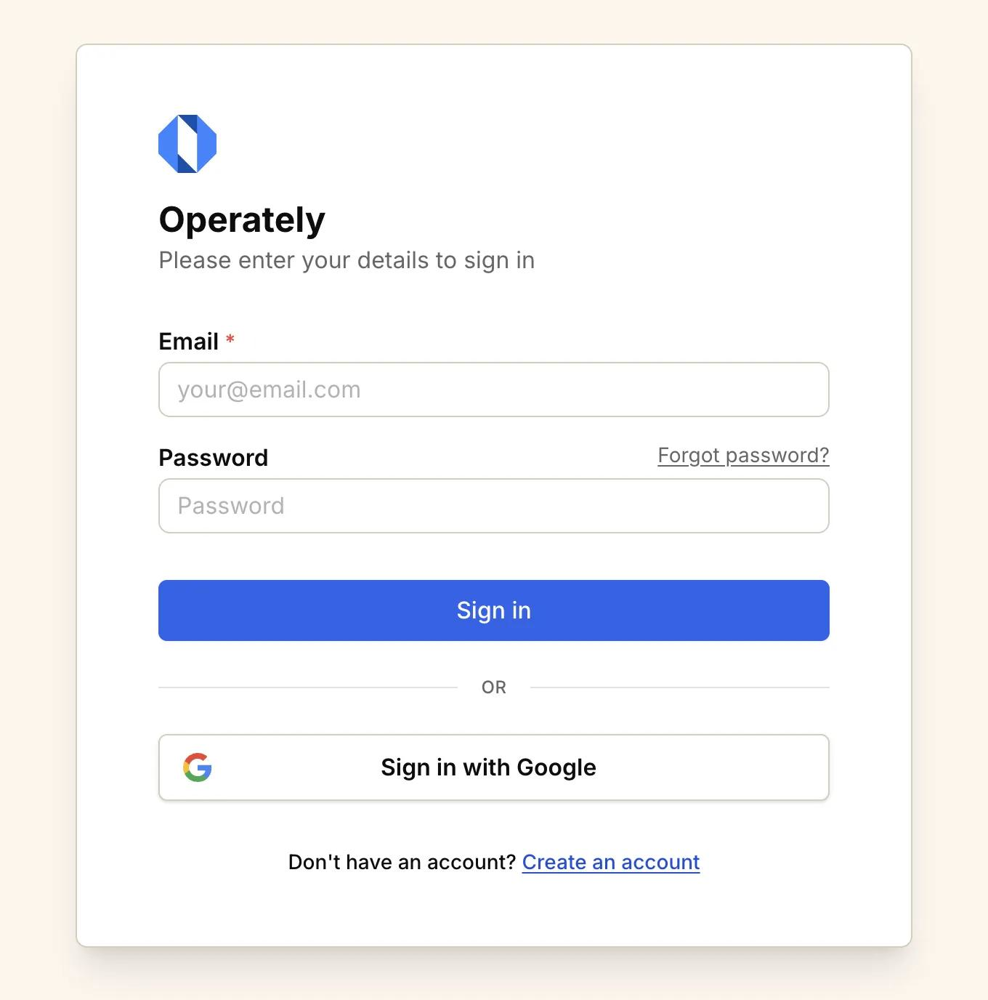
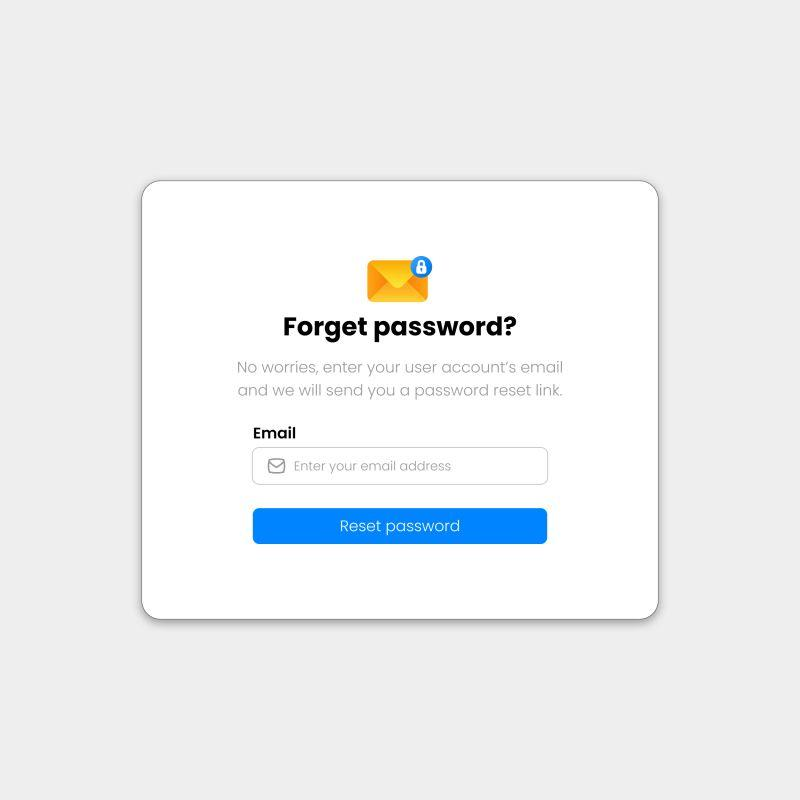

# Рекомендации по организации

| Тип материала | Директория |
| :--- | :--- |
| UI mockups | `assets/mockups/` |
| Architecture diagrams | `assets/diagrams/` |
| Sequence diagrams | `assets/diagrams/sequence/` |
| Screenshots | `assets/screenshots/` |
| API examples | `assets/examples/` |

## Дополнительно:
- Используй **PNG** или **WebP** для UI-макетов.
- Используй **SVG** для векторных диаграмм.
- Имена файлов — `lowercase-kebab-case`.
- Не храни изображения непосредственно рядом с `.md`, если они относятся к общему каталогу макетов.
- Не используй абсолютные ссылки на GitHub.

> **Моя рекомендация:** для `emarket-docs` используй единый каталог `docs/assets/`, а внутри разделяй ресурсы по назначению. Это удобно масштабировать по мере появления новых страниц и микросервисов.

# Login Page

## UI Mockup

## Description

Login page provides user authentication.

### Form fields

- Email (required)
- Password (required)

### Actions

- Sign in
- Sign in with Google
- Forgot password?
- Create an account

# Forgot password Page

## UI Mockup

### Form fields

- Email (required)
